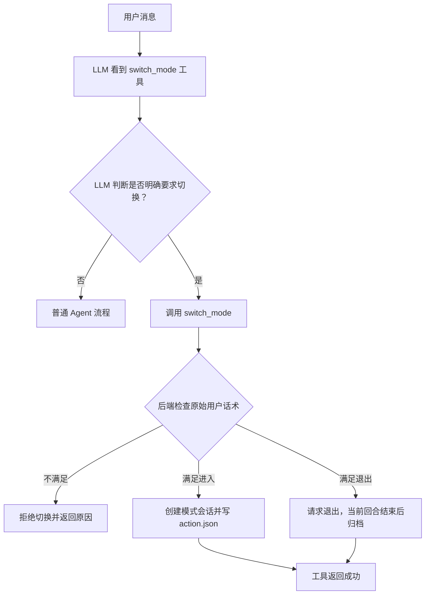
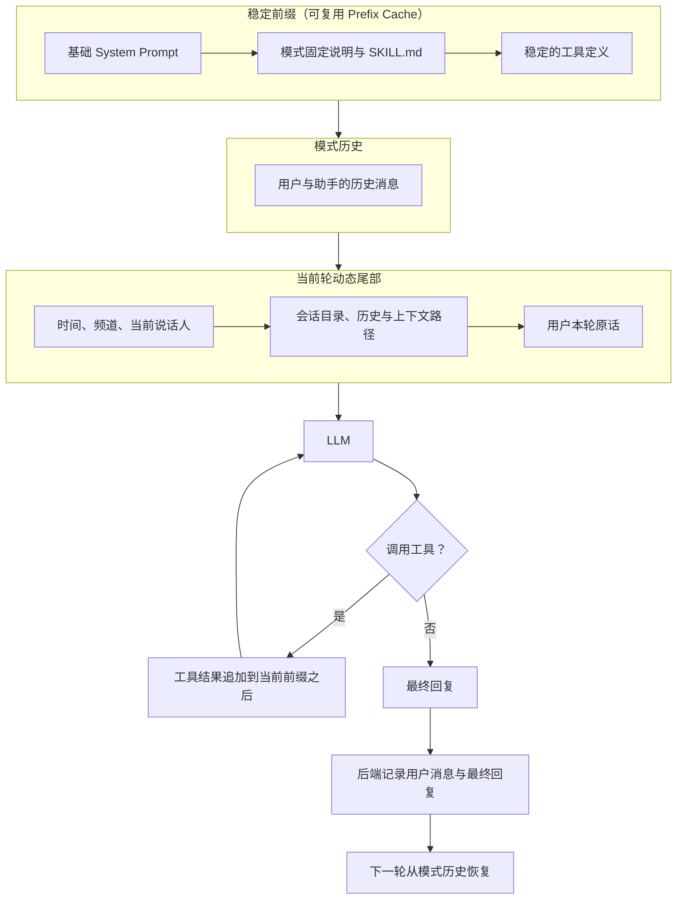
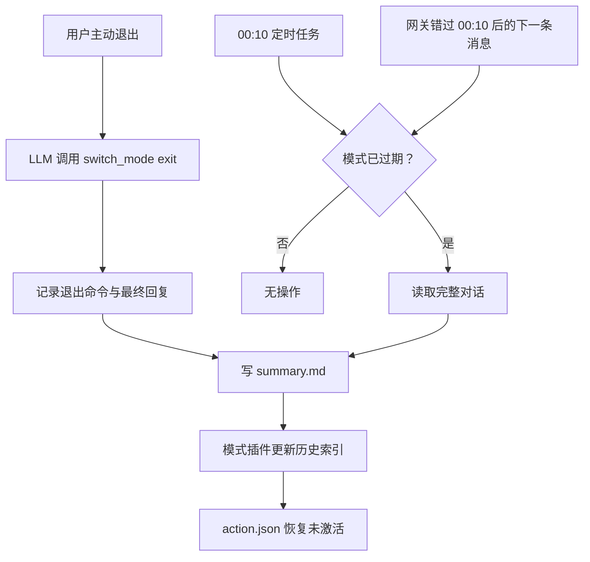

# 运行模式

运行模式让 homebot 在明确的业务场景中切换出独立、可持续的上下文空间。模式不是靠模型猜测话题自动开启，而是由 LLM 调用 `switch_mode` 工具提出切换，后端校验用户原话后完成状态变更。

当前内置一个示例模式：

- `cooking`：做饭模式，见 [做饭模式](../skills/home-cooking.md)。

## 核心组件

```text
homebot/modes/
├── manager.py   # 模式状态、上下文、记录、退出后处理
├── plugin.py    # 模式插件基类
├── registry.py  # 从 Skill 的 mode.json 动态发现插件
└── cron.py      # 跨日自动退出任务
```

| 组件 | 职责 |
|---|---|
| `ModeRegistry` | 扫描 Skill 目录，加载并注册模式插件 |
| `ModeManager` | 读写 `action.json`，构造模式上下文，保存对话，执行退出 |
| `ModePlugin` | 定义某个模式的静态提示词、运行上下文和退出后处理 |
| `switch_mode` | LLM 可调用的唯一模式切换接口 |

一次只能激活一个模式。模式是全局状态，不属于某个聊天频道或某一次的语音会话。

### 目录职责

| 目录 | 内容 |
|---|---|
| `homebot/modes/` | 通用模式内核，不包含任何做饭业务 |
| `homebot/skills/home-cooking/` | 做饭模式的 Skill、注册清单和插件实现 |
| `<workspace>/modes/` | 运行时模式状态和已完成模式会话 |
| `<workspace>/cooking/` | 用户的菜谱、做饭历史和总结 |

新增模式时只需要增加对应 Skill；通用 `homebot/modes/` 不需要复制做饭相关代码。

## 模式切换

LLM 根据用户意图决定是否调用：

```json
{
  "name": "switch_mode",
  "arguments": {
    "action": "enter",
    "mode_id": "cooking"
  }
}
```

后端会校验本轮用户原始文本。进入模式必须同时满足：

- 原话包含该模式的显示名称，例如“做饭模式”。
- 原话包含明确的进入动作，例如“打开”“进入”“开始”“切换”或“启用”。

退出模式同样需要包含模式名称和“关闭”“退出”或“结束”。



模式切换由 LLM 发起，但 LLM 不直接写 `action.json`，也不能绕过后端校验。

## action.json

文件位置：

```text
<workspace>/modes/action.json
```

未激活时：

```json
{
  "schema_version": 1,
  "active": false,
  "mode_id": null,
  "display_name": null,
  "session_id": null,
  "skill_name": null,
  "started_at": null,
  "expires_at": null,
  "session_dir": null,
  "exit_reason": "user"
}
```

未激活状态中的 `exit_reason` 保留最近一次退出原因，新会话进入时会清空。

激活时：

```json
{
  "schema_version": 1,
  "active": true,
  "mode_id": "cooking",
  "display_name": "做饭模式",
  "session_id": "cook-20261022-195500-a1b2c3",
  "skill_name": "home-cooking",
  "started_at": "2026-10-22T19:55:00+08:00",
  "expires_at": "2026-10-23T00:10:00+08:00",
  "session_dir": "C:\\Users\\me\\.homebot\\workspace\\modes\\sessions\\cooking\\cook-20261022-195500-a1b2c3",
  "exit_reason": null
}
```

`action.json` 只保存模式生命周期，不保存菜谱内容或对话正文。

## 模式上下文

普通模式继续使用 homebot 原有会话逻辑。进入模式后，Prompt 改用模式会话：



模式 Skill 的正文在进入模式时写入会话目录下的 `system_prompt.md` 并冻结。模式期间不会改读外部 Skill 文件，保证同一模式会话的 System Prompt 前缀稳定。

模式历史保存为 `conversation.jsonl`。每次请求都从该文件构造历史消息，因此语音频道即使每次唤醒都是新会话，也能继续上一轮做饭对话。

活动模式属于共享上下文，不把某个成员的 `USER.md` 固定注入 System Prompt。当前说话人身份只作为本轮动态信息放在用户消息附近，因此多人交替参与同一模式时不会改变稳定的 System Prompt 前缀。普通模式仍按原逻辑加载当前成员档案。

动态信息只进入当前用户消息，不进入 System Prompt。这样新增的菜谱、人数或说话人不会让整个前缀缓存失效。

模式跨唤醒保存上下文，但不会覆盖语音频道自身的行为协议。`dialogue_state` 仍由模型根据用户意图、
是否需要补充信息和普通语音规则决定；模式系统只负责保存和恢复上下文。

### 文件与 LLM 可见性

| 文件 | 何时读取 | LLM 看到的形式 |
|---|---|---|
| `action.json` | 每次请求前由后端读取 | 不直接注入文件内容，只决定是否存在活动模式 |
| `system_prompt.md` | 模式期间每次请求 | 全文作为 System Prompt 的一部分 |
| `conversation.jsonl` | 模式期间每次请求 | 解析为先后有序的 user / assistant 消息 |
| `summary.md` | 退出时生成，历史查询时按需读取 | 活动中不自动注入 |
| `history.md` | 用户查询历史时按需读取 | 活动中只注入路径，不自动注入全文 |

`system_prompt.md` 是进入模式时冻结的稳定前缀快照。它不是让模型主动读取的额外文件，而是由后端直接加载并拼入 System Prompt。`conversation.jsonl` 是机器可读的完整对话源，后端会将其转换成普通消息历史；模型不会看到 JSONL 的行结构。

## 对话记录

每轮结束后由后端记录，不依赖 LLM 主动写日志：

```json
{
  "timestamp": "2026-10-22T20:05:00+08:00",
  "channel": "voice",
  "chat_id": "voice-session-id",
  "speaker_id": "guest",
  "user": "番茄要放几个？",
  "assistant": "两个人先放两个，约 150 克。"
}
```

模式期间的所有对话都会记录，包括与模式主题无关的旁支内容。

## 退出与归档

退出有两种来源：

- 用户明确要求退出，由 LLM 调用 `switch_mode(action="exit")`。
- 当前时间超过 `expires_at`，由跨日任务自动退出。

主动退出时，LLM 可以在工具参数中提供一份简短总结。后端会在当前回合最终回复生成后依次执行：

1. 把最后一轮用户消息和最终回复写入 `conversation.jsonl`。
2. 生成 `summary.md`。
3. 让模式插件更新自己的历史索引。
4. 把 `action.json` 恢复为未激活。

自动退出使用相同的退出后处理。模式默认在当前日期结束后的 `00:10` 到期。网关不在线或定时任务错过执行时，下一条用户消息处理前也会检查并补做退出。



## 开发新模式

在 Skill 目录中提供三个文件：

```text
homebot/skills/example-mode/
├── SKILL.md
├── mode.json
└── mode.py
```

`mode.json`：

```json
{
  "id": "example",
  "display_name": "示例模式",
  "entrypoint": "mode.py:ExampleMode"
}
```

`mode.py` 继承 `ModePlugin`：

```python
from homebot.modes.plugin import ModePlugin


class ExampleMode(ModePlugin):
    mode_id = "example"
    display_name = "示例模式"
```

不需要自定义时可以只提供最小的静态 Skill。需要额外上下文、数据目录或退出索引时，再覆盖插件方法。模式代码只从本地 Skill 目录加载，不从网络加载。

## 与 Prefix Cache 的关系

本实现主动保持以下内容稳定：

- `system_prompt.md` 在进入模式时冻结。
- 工具定义顺序由 `ToolRegistry` 固定。
- 模式历史只追加，不改写旧消息。
- 动态会话信息放在当前用户消息尾部。

DeepSeek 会自动计算前缀缓存；支持 `cache_control` 的 Provider 继续使用 homebot 原有的缓存标记逻辑。
