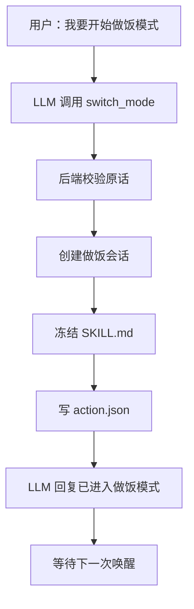
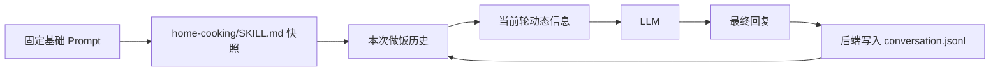

# 做饭模式

`home-cooking` 是运行模式系统的内置示例。它演示一个 Skill 如何注册自己的模式后端、注入完整 Skill 指令、维护独立会话上下文，并在退出时保留历史和生成总结。

做饭模式的代码位于 `homebot/skills/home-cooking/`，包括 `SKILL.md`、`mode.json` 和
`mode.py`。通用模式框架位于 `homebot/modes/`，不应放入做饭专用逻辑。

## 进入模式

用户必须明确说出“做饭模式”和进入动作，例如：

```text
大虾米，我要开始做饭模式。
```

LLM 识别意图后调用 `switch_mode`。后端确认原始话术包含“做饭模式”和“开始”，才会创建会话并写入：

```text
<workspace>/modes/action.json
```

只说“我们在做饭”“今晚吃什么”或“做饭模式是什么”不会进入模式。



## 模式中的上下文

进入模式后，System Prompt 会固定包含完整的 `home-cooking/SKILL.md`。不再使用普通聊天历史作为 Prompt 历史，而是读取本次做饭会话的 `conversation.jsonl`。

做饭模式是多人共享的，因此不会把某位成员的 `USER.md` 固定进 System Prompt。当前说话人只作为本轮动态信息记录。



因此每次重新唤醒“大虾米”后，homebot 仍知道本模式内聊过的菜谱、人数、提问和调整。

做饭模式不会覆盖语音频道的 `dialogue_state` 决策；模型仍可按普通语音规则选择 `end`、
`follow_up` 或 `continuous`，模式历史会在下一次请求时自动恢复。

## 数据位置

用户数据全部位于 workspace：

```text
<workspace>/
├── modes/
│   ├── action.json
│   └── sessions/
│       └── cooking/
│           └── <session-id>/
│               ├── system_prompt.md
│               ├── conversation.jsonl
│               └── summary.md
└── cooking/
    ├── recipes/
    │   ├── index.md
    │   └── <recipe-id>.md
    └── history.md
```

各文件用途：

| 文件 | 用途 |
|---|---|
| `recipes/index.md` | 菜谱目录 |
| `recipes/<recipe-id>.md` | 单道菜谱及修订记录 |
| `conversation.jsonl` | 本次做饭的完整对话记录 |
| `summary.md` | 本次做饭的退出总结 |
| `history.md` | 所有已完成做饭会话的索引 |

用户可以询问：

```text
前几天我们做过什么菜？
上次番茄炒蛋最后怎么调整的？
```

homebot 应先查 `cooking/history.md`，再读取对应会话的 `summary.md`；需要核对原话时再读取 `conversation.jsonl`。

## 菜谱

新增菜谱时，按 `recipes/index.md` 的格式创建独立 Markdown 文件。草稿和已验证菜谱使用相同位置。

菜谱永久调整遵循：

1. 修改菜谱正文。
2. 在菜谱中追加一条修订记录。
3. 不把整段对话复制进菜谱。

只影响一次的调整留在本次会话和总结中，不改菜谱。

## 做饭中的交互

模式内所有消息都进入当前做饭上下文。天气、音乐等旁支问题照常回答，但也要写入 `conversation.jsonl`；旁支内容不能作为修改菜谱的依据。

模式不要求持续报告做饭进度，也不维护“备菜中”“烹饪中”之类状态。系统只记录实际发生的对话。

## 发送菜谱

用户指定接收人时按指定目标发送；只说“发给我”时使用当前说话人信息。当前尚未启用声纹识别，因此无法确定身份时应询问收件人，不得猜测。

## 退出

用户可以说：

```text
关闭做饭模式。
退出做饭模式。
结束做饭模式。
```

LLM 调用 `switch_mode(action="exit")`，后端在最终回复后生成总结、追加 `history.md`，并清除 `action.json`。

如果用户忘记退出，模式会在开始做饭的日期结束后的次日 `00:10` 自动归档并退出。网关停机错过时间时，下一条消息处理前会先补做退出。
